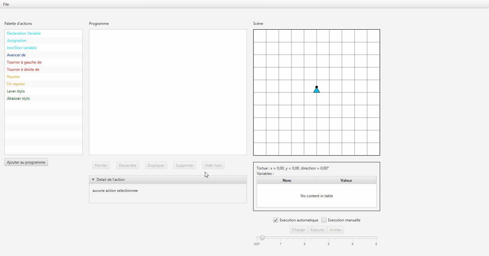
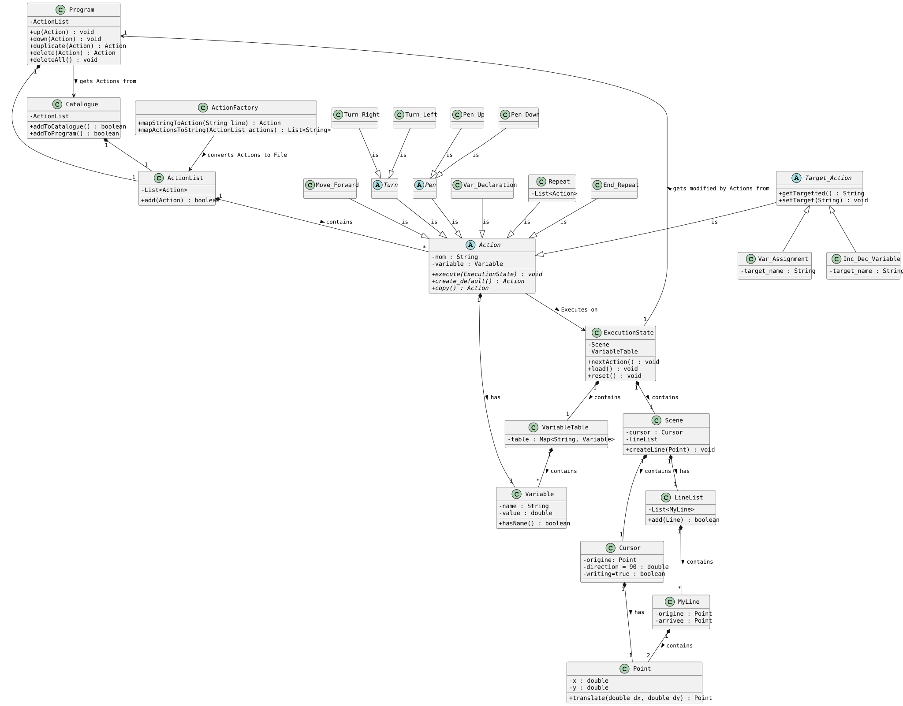
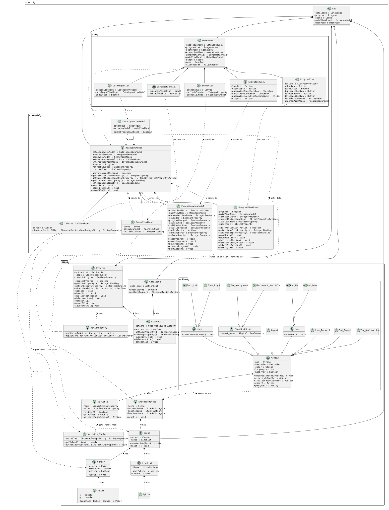

# 🐢 Scratch Turtle Engine — JavaFX MVVM Interpreter


A visual programming environment and interpreter inspired by **Scratch** and **Logo Turtle Graphics**, built with **Java** and **JavaFX**.

This project was developed for the **"Software Analysis & Design Project"** (*Projet d'Analyse et de Conception Logicielle*) course within the Bachelor in Applied Computer Science program at **EPFC (Brussels)**. The domain model and UML class diagrams were designed before the implementation and guided it.

---

## 📽️ Live Demonstration

Automatic execution of a spiral-drawing script (`examples/demo-spiral.scr`): the current instruction is highlighted while the drawing and the variable table update in real time.

<p align="center">
  
</p>

---

## 🎯 Objectives

The project focuses on software design fundamentals:
1. **Domain Analysis:** Defining the semantics of the language (sequences, loops, variables, Cartesian geometry) before writing code.
2. **UML Design First:** Specifying classes, relationships and state management with PlantUML diagrams before implementation.
3. **MVVM Separation:** Keeping the domain model independent from the JavaFX controls through data binding (`ObservableList`, `DoubleProperty`, `BooleanBinding`).
4. **Pre-Execution Checks:** A validation pass detects undeclared variables, unbalanced loops, forbidden changes to loop counters and invalid pen sequences before the program runs.

---

## 📐 1. Analysis & UML Design Phase

The design was done before the implementation, in two complementary views:

### A. Domain Model (Conceptual Business View)
* Captures high-level business concepts: an executable `Program` aggregates an ordered list of `Action` commands running against an `ExecutionState` that manages a vector `Cursor`, geometric lines, and a `VariableTable`.

<p align="center">
  
</p>

* Source file: [`docs/uml/diagramme_classes.puml`](docs/uml/diagramme_classes.puml)
---

### B. Detailed Software Class Diagram (Implementation View)
* Specifies method signatures, inheritance structures (`Target_Action`, `Turn`, `Pen`, `Repeat`, `End_Repeat`), JavaFX observable property types, and loose coupling via ViewModel abstraction layers.

<details>
<summary><b>🔍 Click to expand the full Detailed Software Class Diagram</b></summary>

<br>

<p align="center">
  <a href="docs/uml/diagramme_classe_logiciel.svg" target="_blank">
    
  </a>
  <br>
  <em>(Click on the image or open the source file to inspect in full resolution)</em>
</p>

</details>

* Source file: [`docs/uml/diagramme_classe_logiciel.puml`](docs/uml/diagramme_classe_logiciel.puml)
---

## 🏗️ 2. Software Architecture & Implementation

```text
src/main/java/scratch/
├── model/                     # UI-independent domain core & execution runtime
│   ├── actions/               # Command Pattern: concrete executable instructions
│   ├── ActionFactory.java     # Script serialization & deserialization (.scr)
│   ├── ExecutionState.java    # Execution state (loop stacks & program counter)
│   ├── Program.java           # Pre-execution validation of the script
│   ├── Scene.java             # Vector geometry model & turtle cursor state
│   └── Variable_Table.java    # Dynamic symbol table store
├── viewmodel/                 # Presentation logic & reactive state bindings
│   ├── MainViewModel.java     # Central mediator orchestrating sub-viewmodels
│   ├── ProgramViewModel.java  # Script hierarchy, selection, and mutation bindings
│   ├── ExecutionViewModel.java# Timeline ticker, speed controls, and execution signals
│   ├── SceneViewModel.java    # Vector canvas rendering state
│   └── InformationViewModel.java # Cursor position and variable table
└── view/                      # JavaFX presentation layer
    ├── MainView.java          # Primary application layout & menu bar
    ├── SceneView.java         # Canvas rendering of the drawing
    ├── ProgramView.java       # Visual script editor with automatic indentation
    ├── ExecutionView.java     # Execution dashboard (Auto/Manual controls, slider)
    └── InformationView.java   # Live cursor position and TableView of variables
```
---

### Core Architectural Highlights
* **Command Pattern:** Each instruction (`Move_Forward`, `Turn_Right`, `Repeat`, `Var_Assignment`, etc.) extends the abstract `Action` base class, encapsulating its own parameters, validation logic, and runtime behavior inside `execute(ExecutionState)`. Adding a new instruction does not require changing the execution engine (Open/Closed Principle).
* **Composite Structure (partial):** A `Repeat` block is itself an `Action` that also holds its own `ActionList` of child actions, built by `Program` while the script is edited. This tree is used to compute the nesting depth and indentation in the editor. For execution, I chose a linear approach (program counter + loop stacks, see below) rather than having each `Repeat` execute its children recursively, because it was easier to reason about and fits the step-by-step mode.
* **Loop Stacks:** Nested loops are handled with stacks (`Stack<Integer>` for loop indices and iteration counters inside `ExecutionState`), without recursion.
* **Pre-Execution Validation (`Program.compileProgram()`):** The script is checked before it runs:
  * Variable declarations must be grouped at the top of the script, and variables must be declared before use.
  * Control blocks must be balanced (`Repeat` vs. `End_Repeat`).
  * A loop counter cannot be modified inside its own loop, including from a nested loop.
  * Two identical pen actions (`Pen_Up` / `Pen_Down`) cannot follow each other.
* **Dual Execution Modes:**
  * *Manual Mode:* Step-by-step interactive inspection and debugging.
  * *Automated Mode:* Continuous real-time execution governed by a JavaFX `Timeline`, dynamically synchronized with an execution speed slider.

---

## 👤 Author & Context

* **Student:** Aymen JERIDI — Bachelor in Applied Computer Science (Application Development) at **EPFC (Brussels)**
---

> **⚠️ Portfolio & Academic Notice:**  
> This project was developed strictly for academic demonstration and portfolio purposes as part of a software engineering coursework. It is **not** intended, designed, or maintained for production use.
